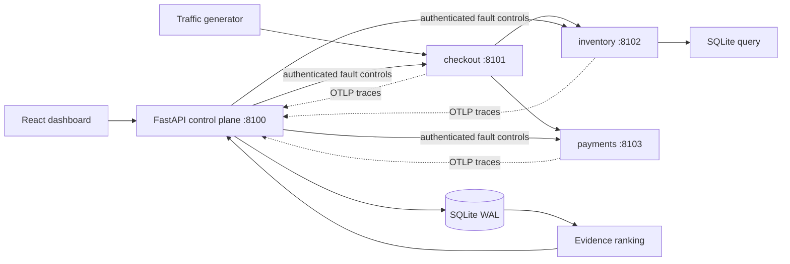

# IncidentLab

**Reproduce the failure. Follow the evidence. Verify the diagnosis.**

IncidentLab is a local distributed-systems laboratory with three independent HTTP services, real OpenTelemetry traces, controlled fault injection, and an explainable incident-ranking engine. Its React dashboard connects the experiment, service map, incident evidence, and trace waterfall in one investigation workflow.

This is a working engineering lab, not a production AIOps platform. It needs no paid services, model API keys, or GPU.

**Independent application integration:** connect an instrumented application in collector-only mode, capture its healthy baseline, and analyse new traffic. The included adapter verifies the actual [Django Oscar shop sandbox](docs/external-applications.md), including its CSRF-protected basket flow, a real SQLite lock failure, and recovery. Upstream source is pinned and remains separate from IncidentLab.

## Run locally

Requires **Python 3.12+**, **Node.js 22.12+ or 24 LTS**, and npm. The default ports are **8100–8103**. Commands work in PowerShell, macOS, and Linux shells; use `python3` where your system requires it.

```sh
git clone https://github.com/LuciferAksh/incidentlab.git
cd incidentlab
python scripts/setup.py
python scripts/dev.py --no-build
```

Open **http://127.0.0.1:8100**. Wait for the healthy baseline to warm up, then select **Slow database → Run experiment**. The completed investigation opens automatically. Inspect the top suspect and its supporting trace, then run **Healthy control** to check for false positives.

Setup creates a repository-local `.venv`, installs pinned Python and Node dependencies, and builds the dashboard. The supervisor chooses that environment automatically and starts all four processes. Stop with **Ctrl+C**. SQLite data and service logs live in ignored `data/` files. Setup requires internet; the running app uses locally bundled fonts and assets.

## What actually works

- **Real service boundaries:** checkout calls inventory and payments over HTTP. The services are separate OS processes, not simulated nodes in the browser.
- **Real tracing:** explicit SDK instrumentation, W3C context propagation, OTLP/HTTP protobuf ingestion, parent-child spans, operation attributes, and structured span events.
- **Explainable ranking:** fresh baseline comparison, p95 latency and error-rate changes, exclusive-time analysis, slow database operations, and local failure evidence.
- **Repeatable experiments:** fresh baseline → fault → 30 observed requests → diagnosis → recovery. Only one experiment runs at a time.
- **Persistent investigation:** SQLite WAL storage for spans and incidents; trace waterfall, ranked evidence, timestamps, and a saved experiment ledger.
- **Honest evaluation:** injected target labels are attached _after_ diagnosis. Healthy controls and fault runs are reported separately. JSON export includes evidence and ground truth.
- **Usable dashboard:** overview, trace search, error filtering, pause/resume, scenario selection, investigation dialogs, evaluation export, responsive layout, and API documentation.

## Architecture



The **data plane** exports observed spans. The **control plane** knows which fault it injects. The diagnosis function accepts only current and baseline spans. See [architecture and design decisions](docs/architecture.md).

## Fault catalog

| Scenario            | Injected behavior                                          | Expected primary suspect |
| ------------------- | ---------------------------------------------------------- | ------------------------ |
| Slow database       | A 350 ms delay inside an inventory SQLite operation        | inventory                |
| Payment outage      | Payments responds with HTTP 503; checkout propagates a 502 | payments                 |
| Inventory outage    | Inventory responds with HTTP 503 before payments is called | inventory                |
| Checkout regression | A 350 ms local processing delay before dependency calls    | checkout                 |
| Healthy control     | The same request workload without an injected fault        | No incident              |

The database fault uses a SQLite user-defined delay function inside a real query. It models slow database work; it is not a reproduction of a particular database optimizer bug. The checkout regression models processing latency, not actual CPU saturation.

## Verify it yourself

After setup, on Windows:

```powershell
.venv\Scripts\python.exe -m pytest -q
.venv\Scripts\python.exe -m ruff check incidentlab scripts tests
.venv\Scripts\python.exe scripts/verify.py --start --rounds 2
npm run build
```

On macOS/Linux, use `.venv/bin/python` instead. Stop any running lab before `--start`, because the verifier owns ports 8100–8103. It uses a temporary telemetry database, checks all five scenarios, rejects concurrent experiments, inspects distributed traces, and confirms services respond normally after recovery. Reports are written to `data/verification.json`.

To verify an already running lab, omit `--start`. These runs are saved in that lab's experiment history. [Validation evidence and limits](docs/verification.md) explain what is covered. GitHub Actions repeats the build, Python tests, static checks, and real-service integration suite on Linux.

## Development

```sh
python scripts/dev.py --no-build
# In another terminal for frontend hot reload:
npm run dev:web
```

The Vite dashboard is at http://127.0.0.1:5173 and proxies `/api` to the backend. `npm run build` creates the bundled dashboard in `web/dist`. The Python supervisor normally builds before starting; `--no-build` reuses the existing build.

The interactive API reference is http://127.0.0.1:8100/docs. Key endpoints:

| Endpoint                  | Purpose                                                                |
| ------------------------- | ---------------------------------------------------------------------- |
| `GET /api/overview`       | Last-minute service metrics, graph, live diagnosis, incident summaries |
| `GET /api/scenarios`      | Supported experiment catalog                                           |
| `POST /api/experiments`   | Start an experiment, e.g. `{"scenario":"inventory-latency"}`           |
| `GET /api/incidents/{id}` | Saved evidence, ground truth, and experiment timeline                  |
| `GET /api/traces`         | Recent root request traces                                             |
| `GET /api/traces/{id}`    | All retained spans in a distributed trace                              |
| `GET /api/report`         | Aggregate local evaluation and full results                            |
| `POST /v1/traces`         | OTLP/HTTP protobuf trace ingestion                                     |

## Boundaries worth knowing

- **Local, trusted use:** the launcher binds to loopback. Do not expose this lab directly to the internet. There is no user authentication, tenant isolation, or production ingestion gateway.
- **Metrics and events are trace-derived.** There is no independent metrics or general-purpose log ingestion pipeline in this release. Span events provide contextual failure details.
- **Ranking is heuristic.** Scores are evidence weights, not confidence probabilities. Parent-child timing is not proof of causation. Missing spans, clock skew, simultaneous faults, and workload changes affect results.
- **Small workload:** experiments use bounded concurrency and a controlled service graph. Local test accuracy does not establish generalization to production systems.
- **Retention:** spans are pruned on ingestion to roughly 24 hours and at most 100,000 rows; pruning runs at most every 30 seconds. Incident history retains the latest 200 results. Supporting traces may expire before incident summaries.
- **No LLM dependency:** evidence explanations are deterministic. An optional, evaluated AI explanation layer is a future extension.

## Next engineering milestones

1. Add an independent OTLP metrics/logs pipeline and detection-delay measurements.
2. Expand to unseen fault types, concurrent faults, partial traces, and workload shifts.
3. Add versioned evaluation datasets and compare ranking against latency-only and error-only baselines.
4. Add PostgreSQL/ClickHouse storage adapters and benchmark ingestion backpressure.
5. Add authenticated read-only deployment before shared hosting.

See [CONTRIBUTING.md](CONTRIBUTING.md) for the change and validation workflow. MIT licensed.
